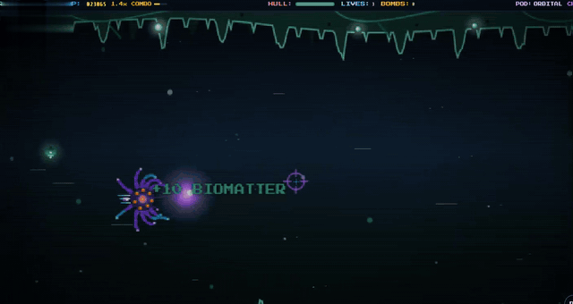
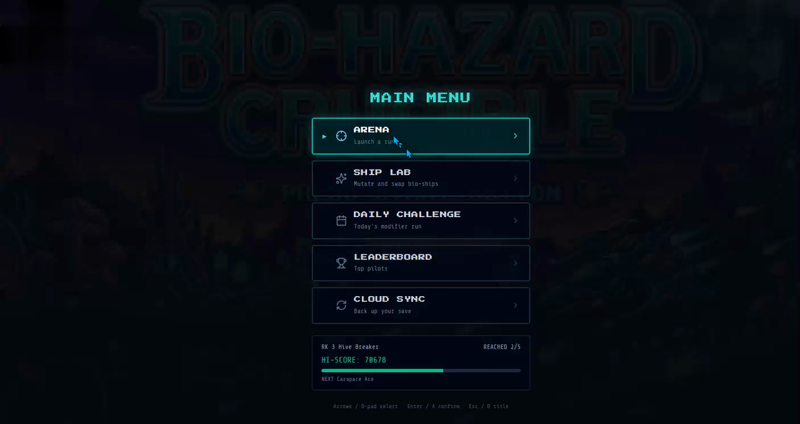
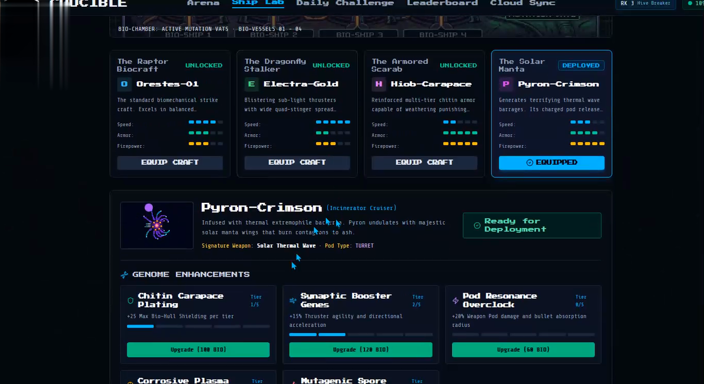

# Bio-Hazard Crucible

A 16-bit style biomechanical side-scrolling shmup by [Ultrademic Studios](https://github.com/Ultrademic). Hazmatic is a working title for this project.

Fly a bio-vessel through five crucible sectors, dock between stages, rank up between runs, and spend harvested biomatter in the ship lab. This is a public code preview of the web arcade: custom Canvas 2D engine, studio music, daily challenges, and local plus in-memory cloud saves. There is no hosted demo yet; run it locally to play.

This is an unofficial fan game inspired by Sega's *Bio-Hazard Battle*. It is not affiliated with, endorsed by, or published by Sega.

## What I built

I designed and built the arcade myself, including:

- A custom 640×360 Canvas 2D engine, driven by `requestAnimationFrame`, with scripted sector waves, bosses, docking between stages, weapon pods, charge shots, and bombs
- An audio system that plays original studio MP3s for the title, ship lab, and each sector, and uses the Web Audio API to synthesize FM combat sound on the fly
- Pilot saves in the browser (`localStorage`), plus a small Express API for daily challenges, leaderboards, and cloud-save codes. Those API records stay in server memory, so they reset when the server restarts
- Input for keyboard, mouse, touch, and the standard Gamepad API, including clip-on controllers

## Run locally

1. Install dependencies: `npm install`
2. Start the arcade server: `npm run dev`
3. Open http://localhost:3000

No API keys are required. The server listens on port 3000 by default, or `PORT` from `.env`.

## What's in the game

- Five scripted sectors with bosses: Organic Sector, Toxic Swampland, Deep Hive, Mutant Funk, and Overgrown Temple
- Four bio-vessels (Orestes-01, Electra-Gold, Hiob-Carapace, Pyron-Crimson) with charge shots, weapon pods, and bombs
- Ship Lab mutations, pilot ranks, a daily challenge, leaderboards, and cloud-save codes
- Keyboard, mouse, touch, and standard gamepad controls (including clip-on controllers)
- Studio MP3 tracks for the title, lab, and each sector, plus Web Audio FM synth for combat sound

Leaderboards and cloud-save codes are stored in the local server's memory, so they reset when the server restarts. Pilot progress is saved in the browser. A boss-rush mode is named in the API but is not a playable menu option yet.

## Tech stack

TypeScript, React 19, Vite, Tailwind CSS 4, and an Express server (started with `tsx`) that mounts Vite in development and can serve the production build. The game runs on a 640×360 Canvas 2D engine.

## Project layout

- `server.ts` — arcade server, leaderboard / daily / cloud-save API
- `src/App.tsx` — title, main menu, and screens
- `src/game/` — engine, input, audio, sectors, ships, saves
- `src/components/` — Arena, Ship Lab, Daily Challenge, Leaderboard, Cloud Sync
- `src/assets/music/` — original Hazmatic tracks
